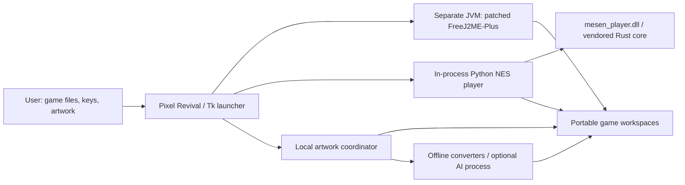
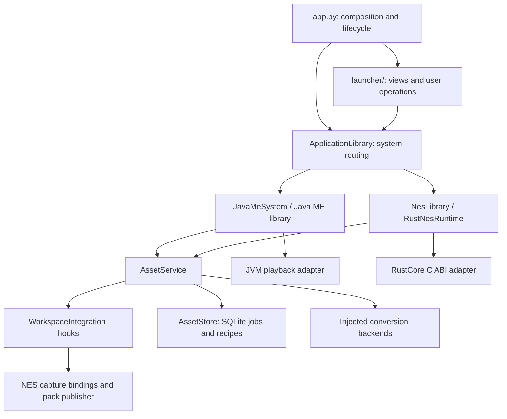
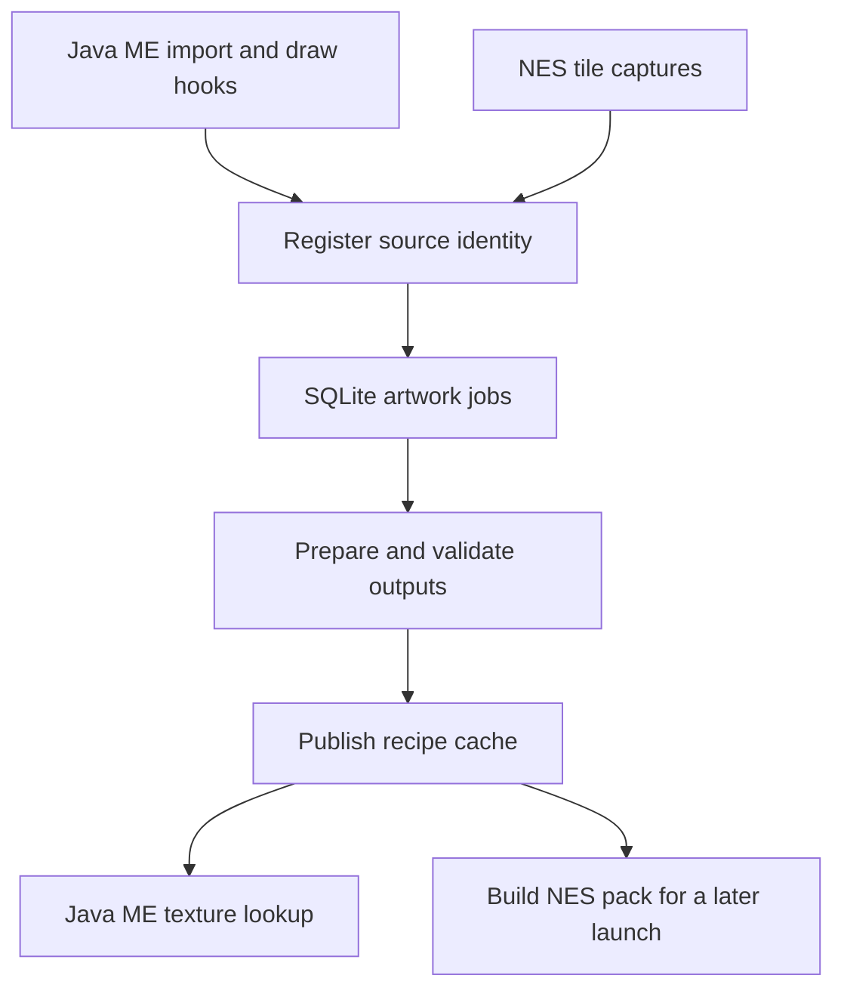
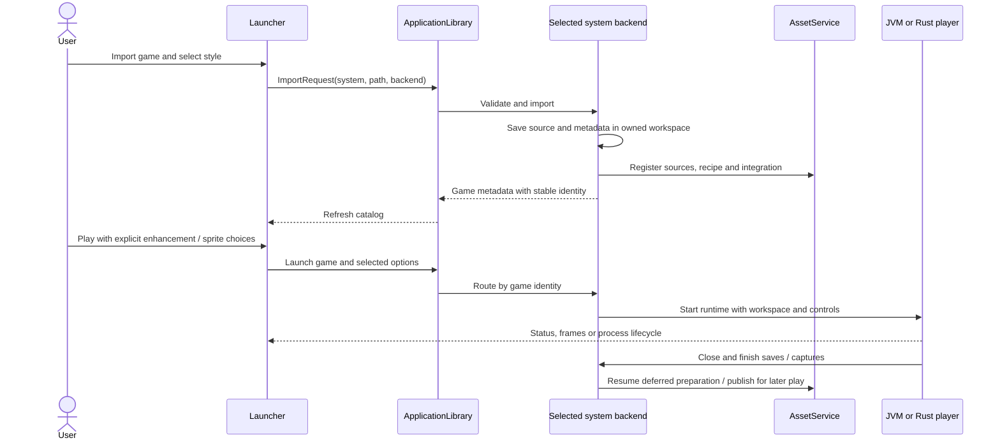
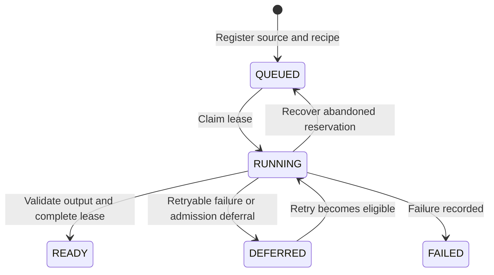

# Pixel Revival architecture and high-level design

Current source architecture, 27 November 2026. This is the project's high-level design (HLD): system boundaries, ownership, interactions and design decisions. The filename is retained for existing links. Feature acceptance and remaining faults live in [Status](STATUS.md); build details live in [Development](DEVELOPMENT.md), and implementation contracts live in [Low-level design](LOW_LEVEL_DESIGN.md).

## Scope and architectural goals

Pixel Revival is a portable Windows desktop application for importing, playing and comparing Java ME and NES games with optional prepared artwork. It combines two emulator integrations with a shared local artwork pipeline. Game execution, source-image discovery, enhancement and replacement are separate responsibilities.

The architecture prioritizes preserving original games and saves, reusing prepared artwork, keeping expensive conversion outside frame rendering, and isolating each system's storage and playback rules. Shared services operate on validated identities and recipes rather than game titles. Experimental character identification has its own boundary and does not establish general compatibility.

Included capabilities are library management, per-system controls, Original/Enhanced playback, paired comparison, local conversion, capture recovery and optional character art. Network multiplayer, cloud save synchronization, general-purpose game-code sandboxing and guaranteed automatic character recognition are outside the current design. The Artwork **Sync** action reconciles local files; it is not cloud synchronization.

## System context and deployment

The launcher, system adapters, artwork coordinator and NES integration run in one Python application. Java ME executes game code in separate JVM processes. The NES core is a native library loaded into Python, so native faults share the launcher's process boundary. Optional AI conversion uses a local executable and model; setup can download dependencies, while prepared artwork is stored locally.

In source mode, resources and saved data are rooted at the checkout. In a portable build, `Pixel Revival.exe` is beside `app/` (bundled resources) and `data/` (writable user data). `storage/paths.py` separates those roots. Changing the product name does not change game identifiers, workspace names or saved-data formats. Previously built previews must be rebuilt to acquire new names and behavior.

## Logical components and dependency direction

`app.py` is the composition root. It creates the recipe/backend provider, the shared artwork service through the Java ME library, the NES capture adapter and the system router. This construction dependency does not make Java ME responsible for NES emulation. NES behavior enters the shared service through `WorkspaceIntegration`, keeping capture interpretation and pack generation outside generic scheduling.

The UI requests operations through `ApplicationLibrary`. `GameRef(system, id)` preserves ownership across filtered views and asynchronous callbacks. `ImportRequest` makes the selected system and artwork backend explicit. Each backend owns import, workspace, preparation, metadata and launch behavior through `SystemBackend`; adding a backend also requires registration, presentation and storage integration. It is not sufficient to add another file extension.

Backend calls run outside the router's lock. The router publishes a catalog index only if its membership revision is still current, preventing stale import/delete routing without holding UI-level locks through slow backend work.

## Runtime ownership

| Component | Current responsibility |
|---|---|
| `app.py`, `launcher/` | Tk library, settings, artwork controls and playback UI |
| `systems/application.py` | Route requests to Java ME or NES |
| `systems/jme/`, `emulator-src/`, `tools/patches/` | Import JARs and launch patched FreeJ2ME-Plus; integrate image/pose hooks |
| `systems/nes/`, `rust-nes/mesen-player/` | Import cartridges, call the vendored Rust core, compose packs/poses and present frames |
| `runtime_assets/` | Persistent artwork queue, conversion, validation and publication |
| `storage/`, `controls/` | Portable paths, saved data and per-system keyboard profiles |

Java ME runs in a separate JVM using its compatibility GPU renderer or per-game CPU mode. GPU selection applies to Java ME playback and artwork inference through their respective settings.

NES runs in the Python process through the Rust C ABI. The emulator worker owns core mutation and audio production. A separate display worker holds at most two immutable frames; Tk owns widgets and teardown. Comparison synchronizes the two NES players at frame boundaries and plays audio only from Enhanced. There is no external managed NES player in the active launch path.

The former plan to render both emulators through one shared graphics implementation is historical. Some native build and packaging support remains; it does not describe the selected playback paths.

## Why the NES player changed

The earlier integration launched managed MesenCE with its own frontend and a bridge into the artwork/presentation stack. The active runtime replaces that player with a direct Python-to-Rust C API. The purpose is direct ownership of the window, controller/frame coordination, audio delivery and capture/replacement hooks, with fewer frontend and bridge boundaries to maintain. This change does not by itself prove better speed or compatibility.

| Layer | Origin and changes |
|---|---|
| `rust-nes/mesen-core/` | Reused Rust port of Mesen 0.9.9; original C++ attribution belongs to Sour. Project-approved changes add HD observation/composition support and actual sprite-fetch observation. |
| `rust-nes/mesen-player/` | Project C ABI wrapper, handle ownership and HD/capture exports exposed as `mesen_player.dll` |
| `systems/nes/` | Project Python integration: library, playback, input/audio/display, comparison, artwork packs and poses |

The emulation core was not reimplemented from zero for this app. Separating core, C ABI and Python integration lets UI/artwork work stay outside CPU/PPU emulation. The source is copied into this repository rather than linked to an external checkout, so builds remain self-contained and authorized project changes stay local to this project. The former managed frontend and shared-renderer plans remain historical records. See [native build and provenance](../rust-nes/README.md).

## Artwork lifecycle

Java ME can prepare recognized resources before play and admit bounded live work when permitted. NES captures are converted into tile bindings; ready outputs are published into an HD pack after play. The loaded NES pack remains fixed for its session. Missing art uses original pixels. General NES tile enhancement currently supports CHR-ROM bindings; pose observation also supports CHR-RAM identities.

Validated enhancement completion updates SQLite directly. Java ME capture events register new sources. Automatic event processing and bounded NES capture ingestion remain; a periodic full original-image catalog scan is not the recovery policy. Explicit **Artwork > Sync**, while players are closed, reconciles missed/legacy files. NES play defers idle maintenance; already dispatched work can still finish. See [asset contracts](ASSET_DECODING.md).

## Play and comparison

The two standalone columns describe normal launcher Play for **both systems**.

| Behavior | Original | Enhanced | Comparison Original | Comparison Enhanced |
|---|---|---|---|---|
| Prepared base artwork | Off | On when ready | Off | On when ready |
| Asset capture | On | On | Off | On |
| Pose capture | On | On | Off | On |
| Selected image/generated poses | Allowed | Allowed | Off | Allowed |

**Enhance play** controls base artwork independently of **Use image** / **Use regenerated poses**. The latter two start unchecked and are mutually exclusive. Capturing poses does not itself select custom artwork. Comparison uses private save copies; captured Enhanced artwork is routed to the main game workspace.

Java ME comparison embeds two JVM players and forwards the same key transitions. Their clocks remain independent; it is not deterministic frame replay. F11 toggles fullscreen in both systems. Java ME Escape leaves fullscreen before closing a windowed comparison; NES Escape closes the pair directly. Standalone close behavior is owned by its player.

## Playable sprite replacement

Java ME records eligible images/draw regions and supported composed sprites. Review and confirm player poses before applying the default image; per-pose images can override it.

NES initial discovery uses native sprites and controller evidence. The optional fetched-byte observer retains actual pattern bytes and palettes, with bounded storage. Original and Enhanced therefore share native identities regardless of replacement pixels. Saved player poses can anchor nearby animation tracking; recurring variants can be imported after close. A default image can fit a newly tracked pose immediately. Generated sets require regeneration for newly learned poses.

The NES overlay accepts overlapping native layers, fits artwork to the pose and blends over the final frame. It cannot restore a hidden background or guarantee occlusion. Initial discovery can select an enemy; missing or ambiguous matches may retain original sprites. **Find enemies** only produces candidates for review, not automatic enemy replacement. Coverage is experimental; see [Status](STATUS.md).

## Startup, import and launch lifecycle

Startup acquires a file lock at `DATA_ROOT/library/.launcher.lock` before creating the main application. Only the lock-owning launcher enables immediate recovery of previous artwork reservations. The application constructs both backends, loads settings, builds the UI and starts background inventory/recovery work. Failure to load the Rust runtime leaves the library usable with NES playback unavailable.

Import inspects the supplied file and retains an owned original. Java ME resource readers normalize recognized images without executing the JAR during extraction. NES inspection establishes cartridge identity and metadata; runtime compatibility may still require a later probe. A successful import is not a promise of executable compatibility or complete artwork extraction.

Launch resolves the game's backend, checks busy/import state, selects controls and supplies the appropriate workspace. Java ME builds JVM arguments for scale, capture, textures and pose mode. NES creates a native handle, restores playback data, loads available pack bindings and starts its frame/audio/display lifecycle. The launcher records player ownership so an already running game cannot silently receive a second normal launch.

After a normal NES close, the existing importer merges bounded observations and learned recurring layouts into the main playable-assets workspace. A crash can lose in-memory learned variants. New tile captures become preparation inputs; they do not modify the already loaded pack.

## Persistent data and ownership

The following paths are relative to `DATA_ROOT`. Source mode uses the checkout as that root; portable mode uses `data/`.

| Data | Owner and purpose |
|---|---|
| `library/<id>/game.jar` | Java ME original source |
| `rendered-games/<id>/` | Java ME metadata, resources, artwork, runtime logs and saves |
| `nes/library/<id>/game.nes` | NES original cartridge |
| `nes/rendered-games/<id>/` | NES metadata, bindings, captures, packs, saves and playable assets |
| `config/` | Application selection and separate Java ME/NES control profiles |
| `library/settings.json` | Existing graphics/device preferences |
| `tools/ai/` | Optional downloaded local AI runtime and model |

Each artwork workspace owns `asset-cache.sqlite`, normalized `original-assets/`, recipe outputs, publication state and capture evidence. SQLite is authoritative for sources, recipes, job state and consumed events. JSON metadata describes game preferences and identity; cached UI counters are not authoritative queue state. Prepared texture directories are player-facing views rather than a substitute for the queue database.

Source-image identity is based on normalized pixels, allowing equivalent inputs to share work within the store. A recipe key includes algorithm/version, model digest, scale, alpha/border policy and settings. Changing a recipe creates a distinct job/output identity rather than relabeling existing enhanced images. NES bindings additionally retain native tile and palette identity so an enhanced image can be mapped back to emulated graphics.

Comparison has private playback save copies for each pane. Enhanced capture deliberately targets the main game's artwork workspace, while comparison playback saves stay separate. Renaming the executable or product requires no save migration if `data/` is preserved beside the new executable. Old native window-class names, patch markers and synthetic demo identifiers are internal compatibility details.

## Artwork scheduling and publication

`AssetService` owns one coordinator and one conversion worker with a bounded dispatch queue. It registers per-game stores, ingests events, obtains job leases, admits work based on playback/resource state and consumes conversion outcomes. Backends are injected by recipe; system-specific discovery and publication enter through workspace hooks.

The diagram summarizes job states rather than every store method. Leases carry owner/token/expiry information so stale workers cannot complete a newer reservation. Conversion writes through temporary work directories, validates images, then records successful completion. Publication exposes ready results through manifests/compatibility directories or a newly generated NES pack. Publication is a distinct step from inference completion; a prepared file does not prove the current player loaded it.

Batch count and pixel budgets bound work; memory/device policy can reduce admission. The UI distinguishes active batch work from reserved jobs. Pausing/deferment affects scheduling, while work already sent to a converter may finish. NES play defers idle maintenance; Java ME can admit bounded live work through guards. These policies reduce competition but do not guarantee constant frame time or zero capture overhead.

Recovery combines stored job rows, idempotent capture-event ingestion and explicit reconciliation. It does not repeatedly rescan the entire original-image tree during normal playback. Manual Sync requires closed players. Malformed NES capture chunks are quarantined through the NES integration boundary rather than passed to the converter as valid assets.

## Concurrency, input, audio and shutdown

| Execution owner | Responsibility and boundary |
|---|---|
| Tk main thread | Widgets, window lifecycle, user choices and queued UI events |
| Launcher background work | Import/preparation, recovery, preview and device discovery; reports back through queues |
| Artwork coordinator | Workspace registration, leases, event discovery and publication scheduling |
| Artwork worker | Conversion and bounded output saving; no direct widget mutation |
| Java ME JVM | Emulation, renderer, Java input/audio and draw/capture hooks |
| NES emulation worker | Mutable native handle, controller state, frame stepping and audio production |
| NES display worker | Immutable frame presentation; queue retains at most two frames |

NES display drops stale pending frames rather than building an unbounded backlog behind a blocked screen. Audio is drained from the core and delivered by the Python audio adapter. Input profiles translate stored key tokens into each system's controls. The comparison controller owns paired key routing and release/close handling; NES additionally coordinates the two workers at frame boundaries. Shared input alone cannot make independently clocked JVM games deterministic.

Application close first closes paired views, then standalone owned views, then shuts down the NES runtime, background executors and artwork service. If NES cannot finish saving safely, the launcher reports the shutdown failure and remains open. Worker teardown must finish before freeing native handles or destroying their presentation targets; the player safety checks cover this boundary. Closing the application is not a promise that every deferred enhancement job completed: durable rows permit recovery on restart.

## Failure handling and trust boundaries

| Failure or boundary | Current response / architectural limit |
|---|---|
| Missing or incompatible NES DLL | Runtime unavailable; imported games remain in the library |
| Missing prepared artwork | Native pixels or scaled native output remain available |
| Invalid source image, binding or output | Validation rejects it; job/capture diagnostics retain the reason |
| Interrupted artwork owner | Lock-authorized restart recovery or lease recovery releases unfinished reservations |
| Pose observation/replacement failure | Optional hook disables with a logged reason; native fallback remains |
| Ambiguous initial player identity | May miss the player or select the wrong sprite; human review and current limits remain necessary |
| Presenter failure | Worker records error; it must not continue feeding an unlimited display queue |
| Unsupported cartridge/controller | Runtime reports unsupported/error; import does not invent emulator support |
| Untrusted JAR | Separate JVM is an execution boundary, not a security sandbox |

Archive resource names, capture paths and output manifests are validated at their owning boundaries. They must not become arbitrary filesystem destinations. SQLite transactions and atomic JSON/output replacement protect local updates; they do not replace backups or prove survival of every power-loss scenario. No cloud service is required for ordinary playback or cached artwork lookup.

## Architectural decisions and tradeoffs

| Decision | Reason and consequence |
|---|---|
| Separate system adapters behind one router | Common UI behavior with system-owned import, storage and launch contracts |
| Direct Rust C ABI for NES | Application owns presentation and hooks; native failure isolation is weaker than a separate process |
| Separate JVM for Java ME | Retains FreeJ2ME compatibility/integration; comparison needs embedding and independent-process lifecycle management |
| Offline prepared artwork | Reuses expensive conversion; unseen NES graphics normally improve a later session |
| SQLite jobs plus filesystem outputs | Durable scheduling and reusable files; publication/recovery must reconcile both sides |
| Native sprite identities for NES poses | Enhanced RGB cannot corrupt identity matching; correct initial character selection remains difficult |
| Private comparison saves | Avoids writing paired playback progress into normal saves; captures need an explicit main-workspace destination |
| Existing data paths retained across rename | Product branding can change without rewriting users' game libraries |

The managed NES frontend and shared-renderer architecture are historical. Shared graphics staging still exists in build/package tooling and must be audited before removal. Its presence does not select that renderer for normal playback. The external upstream checkout is reference-only; current builds use the vendored source.

## Verification and design maintenance

Architecture is traced to [app composition](../app.py), [routing contracts](../systems/contracts.py), [router](../systems/application.py), [Java ME launch](../systems/jme/playback.py), [NES library](../systems/nes/library.py), [NES player](../systems/nes/rust_player.py), [artwork service](../runtime_assets/service.py) and [portable paths](../storage/paths.py). The [low-level design](LOW_LEVEL_DESIGN.md) maps individual contracts and checks to their files.

Focused checks can establish routing, store transitions, data validation and lifecycle invariants. They cannot establish all-game compatibility, complete player-animation coverage, driver smoothness or user acceptance. [Status](STATUS.md) separates implemented code from those open outcomes. [Experiments](EXPERIMENTS.md) retains failed and partial measurements. Update this HLD and its contract map when ownership, process boundaries, saved formats or runtime selection change.
