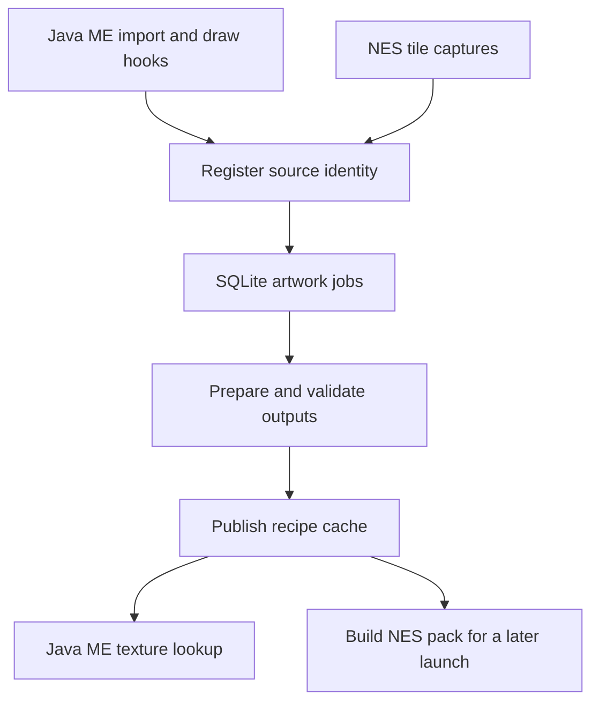

# Project flow

Current source architecture, 26 November 2026. Feature acceptance and remaining faults live in [Status](STATUS.md); build details live in [Development](DEVELOPMENT.md).

## Runtime ownership

| Component | Current responsibility |
|---|---|
| `app.py`, `launcher/` | Tk library, settings, artwork controls and playback UI |
| `systems/application.py` | Route requests to Java ME or NES |
| `systems/jme/`, `emulator-src/`, `tools/patches/` | Import JARs and launch patched FreeJ2ME-Plus; integrate image/pose hooks |
| `systems/nes/`, `rust-nes/mesen-player/` | Import cartridges, call the vendored Rust core, compose packs/poses and present frames |
| `runtime_assets/` | Persistent artwork queue, conversion, validation and publication |
| `storage/`, `controls/` | Portable paths, saved data and per-system keyboard profiles |

Java ME runs in a separate JVM using its compatibility GPU renderer or per-game CPU mode. GPU selection applies to Java ME playback and artwork inference through their respective settings.

NES runs in the Python process through the Rust C ABI. The emulator worker owns core mutation and audio production. A separate display worker holds at most two immutable frames; Tk owns widgets and teardown. Comparison synchronizes the two NES players at frame boundaries and plays audio only from Enhanced. There is no external managed NES player in the active launch path.

The former plan to render both emulators through one shared graphics implementation is historical. Some native build and packaging support remains; it does not describe the selected playback paths.

## Why the NES player changed

The earlier integration launched managed MesenCE with its own frontend and a bridge into our artwork/presentation stack. We removed that player from the active runtime and rebuilt the application integration around a direct Python-to-Rust C API. The purpose is direct ownership of the window, controller/frame coordination, audio delivery and capture/replacement hooks, with fewer frontend and bridge boundaries to maintain. This change does not by itself prove better speed or compatibility.

| Layer | Origin and changes |
|---|---|
| `rust-nes/mesen-core/` | Reused Rust port of Mesen 0.9.9; original C++ attribution belongs to Sour. Project-approved changes add HD observation/composition support and actual sprite-fetch observation. |
| `rust-nes/mesen-player/` | Project C ABI wrapper, handle ownership and HD/capture exports exposed as `mesen_player.dll` |
| `systems/nes/` | Project Python integration: library, playback, input/audio/display, comparison, artwork packs and poses |

The emulation core was not reimplemented from zero for this app. Separating core, C ABI and Python integration lets UI/artwork work stay outside CPU/PPU emulation. The source is copied into this repository rather than linked to an external checkout, so builds remain self-contained and our authorized changes stay local to this project. The former managed frontend and shared-renderer plans remain historical records. See [native build and provenance](../rust-nes/README.md).

## Artwork lifecycle

Java ME can prepare recognized resources before play and admit bounded live work when permitted. NES captures are converted into tile bindings; ready outputs are published into an HD pack after play. The loaded NES pack remains fixed for its session. Missing art uses original pixels. General NES tile enhancement currently supports CHR-ROM bindings; pose observation also supports CHR-RAM identities.

Validated enhancement completion updates SQLite directly. Java ME capture events register new sources. Automatic event processing and bounded NES capture ingestion remain; a periodic full original-image catalog scan is not the recovery policy. Explicit **Artwork > Sync**, while players are closed, reconciles missed/legacy files. NES play defers idle maintenance; already dispatched work can still finish. See [asset contracts](ASSET_DECODING.md).

## Play and comparison

The two standalone columns describe normal launcher Play for **both systems**.

| Behavior | Original | Enhanced | Comparison Original | Comparison Enhanced |
|---|---|---|---|---|
| Prepared base artwork | Off | On when ready | Off | On when ready |
| Asset capture | On | On | Off | On |
| Pose capture | On | On | Off | On |
| Selected image/generated poses | Allowed | Allowed | Off | Allowed |

**Enhance play** controls base artwork independently of **Use image** / **Use regenerated poses**. The latter two start unchecked and are mutually exclusive. Capturing poses does not itself select custom artwork. Comparison uses private save copies; captured Enhanced artwork is routed to the main game workspace.

Java ME comparison embeds two JVM players and forwards the same key transitions. Their clocks remain independent; it is not deterministic frame replay. F11 toggles fullscreen in both systems. Java ME Escape leaves fullscreen before closing a windowed comparison; NES Escape closes the pair directly. Standalone close behavior is owned by its player.

## Playable sprite replacement

Java ME records eligible images/draw regions and supported composed sprites. Review and confirm player poses before applying the default image; per-pose images can override it.

NES initial discovery uses native sprites and controller evidence. The optional fetched-byte observer retains actual pattern bytes and palettes, with bounded storage. Original and Enhanced therefore share native identities regardless of replacement pixels. Saved player poses can anchor nearby animation tracking; recurring variants can be imported after close. A default image can fit a newly tracked pose immediately. Generated sets require regeneration for newly learned poses.

The NES overlay accepts overlapping native layers, fits artwork to the pose and blends over the final frame. It cannot restore a hidden background or guarantee occlusion. Initial discovery can select an enemy; missing or ambiguous matches may retain original sprites. **Find enemies** only produces candidates for review, not automatic enemy replacement. Coverage is experimental; see [Status](STATUS.md).
